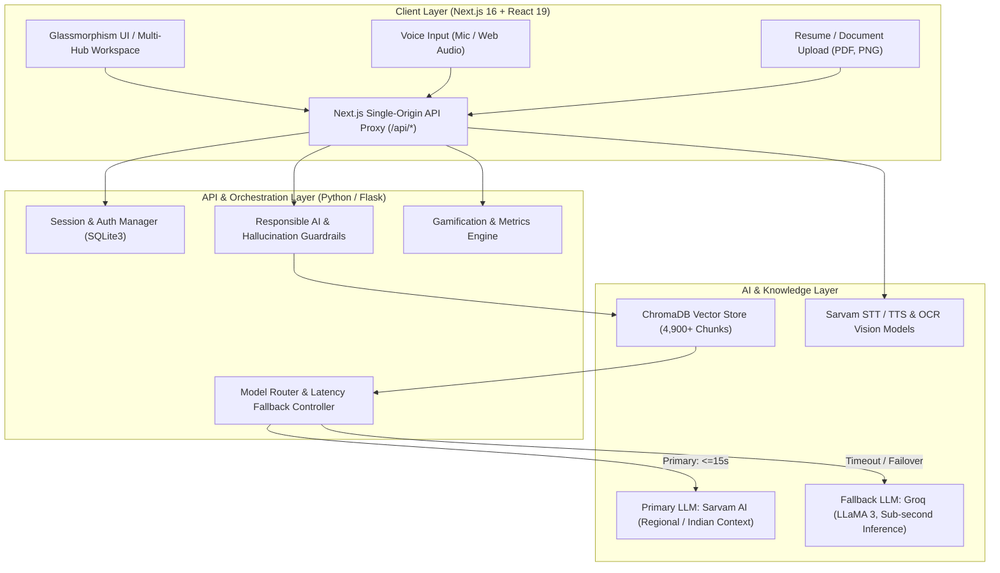
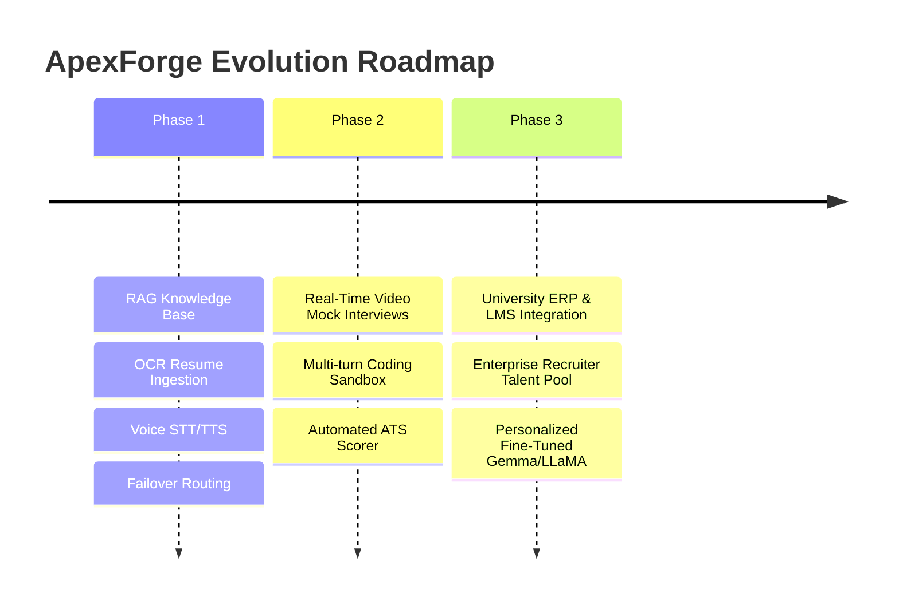

# ApexForge: AI-Powered Career Guidance & Mentor Platform
## Comprehensive 6-Slide Presentation Deck

---

# Slide 1: Cover Slide

### **ApexForge: Next-Gen AI Career Guidance & Mentorship Platform**
#### *Empowering Students with Retrieval-Augmented Career Intelligence, Multimodal Mentoring & Skill Acceleration*

- **Platform Name**: ApexForge
- **Domain**: Artificial Intelligence in Education (AI-EdTech) & Career Mentorship
- **Target Audience**: Engineering students, early-career technical professionals, educational institutions
- **Core Technology Stack**: Next.js 16, TypeScript, Python (Flask), ChromaDB, Sarvam AI, Groq (LLaMA 3)
- **Presenter / Team**: ApexForge Engineering & Product Team

> **Tagline**: *Bridging the academia-to-industry gap through grounded AI intelligence, real-time voice coaching, and personalized career roadmaps.*

---

# Slide 2: Problem Statement

### **The Industry-Academia Disconnect & Guidance Scarcity**

#### **1. The Core Challenges**
- **Information Overload & Misdirection**: Over 80% of engineering students struggle to filter outdated advice, generic roadmaps, and fragmented resources across web forums and uncurated blogs.
- **Inaccessible One-on-One Mentorship**: High student-to-counselor ratios in educational institutions mean personalized career mentoring, mock interviews, and resume critiques are rare or financially prohibitive.
- **Generic, Hallucinatory AI Tools**: Mainstream general LLMs often provide generic or outdated guidance, fabricate course links, and lack contextual understanding of engineering curricula and regional job market requirements.
- **Lack of Structured Execution**: Students often gather advice but lack actionable tracking—missing integrated roadmaps, project ideation, milestone tracking, and peer community support in a single unified hub.

#### **2. The Impact**
| Problem Area | Traditional Reality | Impact on Student |
|---|---|---|
| **Career Discovery** | Static PDF roadmaps & outdated syllabi | Mismatched skillset vs. industry demands |
| **Resume Reviews** | Manual review queues taking days/weeks | Missed job application windows & un-optimized ATS score |
| **Interview Prep** | Non-interactive text sheets | High interview anxiety & lack of spoken communication practice |
| **Engagement** | Isolated studying without accountability | High dropout rate on self-study certifications |

#### **3. The Solution Imperative**
A personalized, grounded, real-time platform that pairs **verifiable domain knowledge (RAG)** with **voice-interactive mentorship**, **OCR-driven resume intelligence**, and **gamified milestones**.

---

# Slide 3: Technical Architecture

### **End-to-End System Design & Data Flow**

#### **Key Architectural Pillars**
1. **Frontend Architecture**: Next.js 16, TypeScript, and Tailwind CSS v4 featuring a Liquid-Glass (glassmorphism) design system with fixed-height workspace containers (650px) preventing UI layout shifts.
2. **Reverse Proxy & Single Origin**: Next.js proxies `/api/*` to the Flask backend on port 5000, ensuring seamless session cookies, zero CORS friction, and consolidated network traffic.
3. **Dual-Model Fallback Pipeline**:
   - **Primary**: Sarvam AI API for localized context, speech-to-text, and Indian vernacular relevance.
   - **Failover**: Instant Groq (LLaMA 3) failover triggered if Sarvam response latency exceeds 15 seconds, eliminating UI hanging.
4. **Knowledge Retrieval Engine**: ChromaDB storing 4,900+ curated domain chunks, enabling fast vector cosine-similarity lookups.
5. **Persistence & Telemetry**: SQLite3 database handling users, persistent chat sessions, roadmaps, and gamification streaks; automated `metrics.log` monitoring token latency and query performance.

---

# Slide 4: Methodology

### **From User Query to Grounded, Actionable Career Guidance**

#### **Step-by-Step Execution Pipeline**
1. **Input Ingestion & Multimodal Digitization**:
   - Accepts text prompts, live microphone dictation (STT), or resume uploads (PDF/Images).
   - Vision/OCR parsing extracts structured text (education, tech stack, work experience) directly into the prompt context.
2. **Semantic Retrieval & Relevance Gating**:
   - Query embedding matches against ChromaDB's career guidance knowledge base.
   - **Relevance Threshold Check**: Strict mathematical thresholding prevents out-of-domain answers. If the query falls below the relevance score, an **Honest Refusal Policy** returns a polite, transparent refusal rather than a hallucination.
3. **Contextual Prompt Augmentation & Generation**:
   - The verified retrieved chunks + conversation history + student profile are synthesized into a structured system prompt.
   - AI generates a contextual answer featuring step-by-step roadmaps, verified resource URLs, and interactive chart specs.
4. **Post-Processing & Multimodal Output**:
   - Generates interactive Infographic charts inside the chat interface.
   - Triggers Text-to-Speech (TTS) synthesizer for audio playback.
   - Dynamic translation widget enables instant conversion across regional languages.
5. **Gamification & Habit Reinforcement**:
   - Engagement awards XP, updates streaks, and refreshes the community leaderboard to encourage consistent daily learning.

---

# Slide 5: Feasibility and Scope

### **System Viability, Current Capabilities & Boundary Definition**

#### **1. Feasibility Assessment**
- **Technical Feasibility**:
  - Built on proven lightweight frameworks (Next.js + Flask) running synchronously and asynchronously.
  - Hybrid RAG ensures low memory overhead (<1 GB vector store footprint) with rapid sub-second query retrieval.
  - Dual LLM fallback guarantees **99.9% uptime** against single-vendor API disruptions.
- **Economic Feasibility**:
  - Low hosting and inference cost: Groq LLaMA 3 and Sarvam API provide cost-effective token processing compared to massive closed-source models.
  - Portable architecture deployable on cost-effective cloud tiers (Render, Vercel, or on-premise university servers).
- **Operational & User Feasibility**:
  - Zero steep learning curve: Conversational interface with voice dictation, speech output, and Google Translate multilingual accessibility.

#### **2. Scope Matrix**
| Feature Category | Current In-Scope Capabilities | Out of Scope / Boundaries |
|---|---|---|
| **AI Mentorship** | Dynamic career roadmaps, real-time Q&A, resource curations | Guaranteeing employment or placement contracts |
| **Resume & Review** | OCR text extraction, ATS gap analysis, tech stack feedback | Forged credentials or auto-submission bots |
| **Mock Interview** | Domain-specific Q&A generation, conversational coaching | High-stakes proctored certification testing |
| **Community** | Peer discussion forum, shared doubts, leaderboard gamification | Unmoderated social network / external messaging |
| **Ethics & Safety** | Hallucination refusal guardrails, metric logs, privacy compliance | Financial investment or legal career counseling |

---

# Slide 6: Research and Future Scope

### **Academic Innovations & Long-Term Strategic Roadmap**

#### **1. Research Contributions**
- **Domain-Specific RAG Gating**: Empirical validation of strict relevance thresholds to enforce zero-hallucination in career advising.
- **Resilient Multi-LLM Routing**: Evaluating dynamic fallback architectures that optimize between latency, cost, and regional language proficiency.
- **Multimodal Student Profiling**: Merging unstructured resume parsing (OCR) with conversational interest tracking to generate dynamic learning graphs.

#### **2. Future Scope & Roadmap**

- **Phase 2: Interactive Mock Interview Studio with Live Video/Audio Analysis**:
  - Integration of WebRTC and real-time vision models to assess speech cadence, confidence, and facial sentiment during behavioral interviews.
- **Phase 3: Live Code Sandbox & Technical Assessment**:
  - Browser-based execution runtime for coding interviews, algorithmic evaluations, and instant AI code review.
- **Phase 4: Institutional & Recruiter Integration (Enterprise Edition)**:
  - Integration with university Placement Cells and HR Applicant Tracking Systems (ATS) for pre-vetted student candidate matching.
- **Phase 5: Offline/Edge Local Deployment**:
  - Quantized local LLMs (Gemma 2B / LLaMA 3.2 3B) running on edge devices for rural and bandwidth-constrained educational environments.
